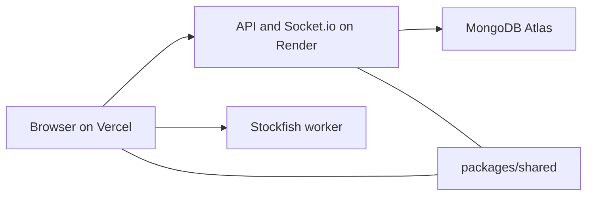

# ChessArena

ChessArena is a real-time chess app. Sign in, play the computer or another person, solve the daily puzzle, and follow ratings on a leaderboard. The board is the page. The server decides what is legal.

## Stack

MongoDB, Express, React, and Node, plus Socket.io for live games, chess.js for the rules, and Stockfish in the browser for the computer opponent.

- **Web:** Vite, React, TypeScript, Tailwind CSS on Vercel
- **API:** Express, TypeScript, Mongoose, Socket.io on Render
- **DB:** MongoDB Atlas
- **Shared:** Zod schemas and chess helpers in `packages/shared`

## Live demo

| Surface | URL |
|---------|-----|
| Web | https://chess-arena-riou.vercel.app |
| API | https://chessarena-server-uzin.onrender.com |

The Render free tier sleeps. The first request after idle can take a while. Hit [`/api/health`](https://chessarena-server-uzin.onrender.com/api/health) once before a demo. A healthy body is `{ "ok": true, "mongo": "up" }`.

## Architecture



The browser holds the access token in memory and sends the refresh token as an httpOnly cookie. Stockfish runs in a worker and never writes a move by itself. Both apps import `@chessarena/shared`.

## Demo

1. Sign up.
2. Play one move against the computer.
3. Find a match, or challenge someone from the lobby.
4. Open the daily puzzle.

<!-- Add the recording at `docs/demo.gif` when it exists. It should show those four steps on the board, not the settings screens. -->

## Setup

Node.js 20 or newer, and a MongoDB connection string.

```bash
npm install
cp apps/api/.env.example apps/api/.env
cp apps/web/.env.example apps/web/.env
```

`apps/api/.env`:

- `MONGODB_URI` — Atlas connection string
- `CORS_ORIGIN` — `http://localhost:5173` locally. Never `*`
- `PORT` — optional, `4000`
- `JWT_ACCESS_SECRET` and `JWT_REFRESH_SECRET` — two different long random strings

`apps/web/.env`:

- `VITE_API_URL` — `http://localhost:4000`

Do not commit `.env` files.

```bash
npm run dev
npm run seed:puzzles -w @chessarena/api
npm test
```

- Web: http://localhost:5173
- Health: http://localhost:4000/api/health
- Sign up at `/signup`. Reload restores the session. Log out sends `/home` back to `/login`
- Play vs AI from `/home`. The daily puzzle is `/puzzles`. It comes from Lichess once per UTC day. The seed is only the fallback when Lichess is unavailable

### Deploy

1. Atlas: free cluster, database user, and `0.0.0.0/0` if Render has no stable egress IP.
2. Render: this repo, `render.yaml`, service name `chessarena-api`. Set `MONGODB_URI`, `CORS_ORIGIN` to the Vercel origin, and both JWT secrets. `NODE_ENV=production` turns on `Secure` and `SameSite=None` for the refresh cookie.
3. Vercel: repo root, `vercel.json`. Set `VITE_API_URL` to the Render origin with no trailing slash.

Open the Vercel URL. The status line should say the API is OK, and `/api/health` should allow that origin specifically.

## Technical decisions

The server is the source of truth for moves, clocks, ratings, and puzzle solutions. Full weekly notes are in [DECISIONS.md](DECISIONS.md).

- Access tokens last 15 minutes and stay in memory. The refresh token is an httpOnly cookie for 7 days.
- Stockfish is a browser worker. The API checks the move it proposes.
- Matchmaking, lobby presence, and the login rate limit live in the API process. A second instance would need a shared store.
- Puzzle lines stay on the server. The daily puzzle is Lichess’s public daily puzzle, fetched once per UTC day with the `User-Agent` `ChessArena` and cached by date. Lichess puzzle data is CC0. The page links to the puzzle on Lichess. The 60 positions in `apps/api/src/data/puzzles.json` are the offline fallback.
- The theme follows the operating system until the player toggles it. The board stays green and cream.

## Future improvements

- Resposive Design(For Mobile)
- A custom engine instead of only Stockfish
- A Redis adapter so Socket.io can run on more than one process
- Time controls other than 10+5
- Mobile App(For Android and IOS, will build using Flutter)

## Security

Passwords are bcrypt at cost 12. JWT secrets come from the environment. Login and signup allow 5 attempts per 15 minutes per IP. CORS is an allowlist. Sockets require a valid access token. Two-factor auth and refresh-token reuse detection are not built.

## Testing

`npm test` builds `@chessarena/shared`, then runs the API Jest suite: rules, ELO, JWT, signup, one AI move, and queue pairing. The database is in-memory. Sockets and the browser are not in that suite.

| Command | Description |
|---------|-------------|
| `npm run dev` | Watch shared, API, and web |
| `npm run build` | Production build |
| `npm run typecheck` | Typecheck every workspace |
| `npm test` | Shared build, then API tests |
| `npm start` | Start the built API |
| `npm run seed:puzzles -w @chessarena/api` | Upsert the fallback puzzles |
